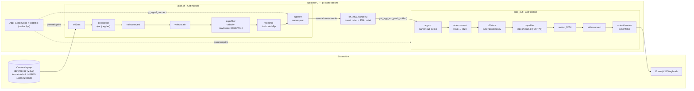
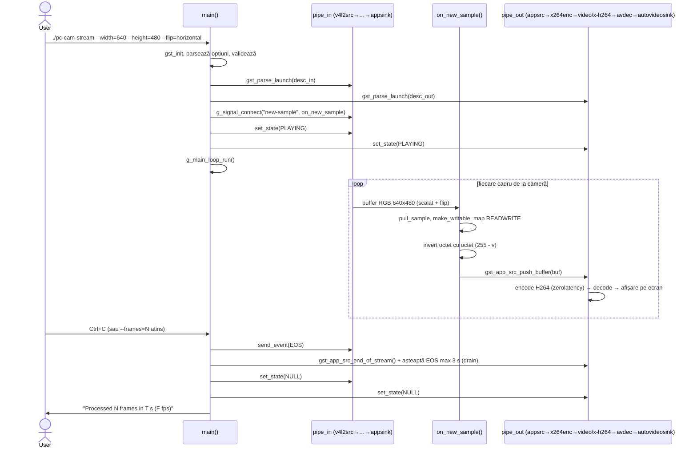

# PcCamStream — arhitectură (UML)

Diagrame Mermaid (randate automat de GitHub). Sursa PlantUML echivalentă: `docs/architecture.puml`.

## 1. Diagrama de componente / flux de date



> De ce două pipeline-uri: într-o singură conductă, ramura `appsrc` nu produce niciun buffer
> până nu e alimentată din callback, iar pipeline-ul așteaptă în preroll buffer de la toate
> sink-urile → deadlock. Două pipeline-uri rezolvă asta.

## 2. Diagrama de secvență — pornire, ciclul unui cadru, oprire



## 3. Diagrama de clase — structurile și funcțiile C (`src/main.c`)

```mermaid
classDiagram
  class App {
    +loop: GMainLoop*
    +pipe_in: GstElement*
    +pipe_out: GstElement*
    +appsrc: GstElement*
    +proc: GstElement* (appsink)
    +frames: gint64
    +max_frames: gint64
    +t0: gint64
  }
  class main() {
    +parsează opțiuni (GOptionContext)
    +construiește desc_in / desc_out
    +gst_parse_launch() x2
    +set_state(PLAYING) x2
    +g_main_loop_run()
    +oprire gracioasă (EOS + drain 3 s)
  }
  class on_new_sample() {
    +pull_sample()
    +make_writable + map READWRITE
    +invert: 255 - octet
    +gst_app_src_push_buffer()
  }
  class on_bus() {
    +GST_MESSAGE_ERROR → quit
    +GST_MESSAGE_EOS → quit
  }
  class on_sigint() {
    +g_main_loop_quit()
  }
  class flip_method() {
    +horizontal→horizontal-flip, vertical, 180, none
  }

  main --> App : construiește
  main ..> on_new_sample : g_signal_connect("new-sample")
  main ..> on_bus : gst_bus_add_watch
  main ..> on_sigint : g_unix_signal_add
  main ..> flip_method : validează --flip
```
